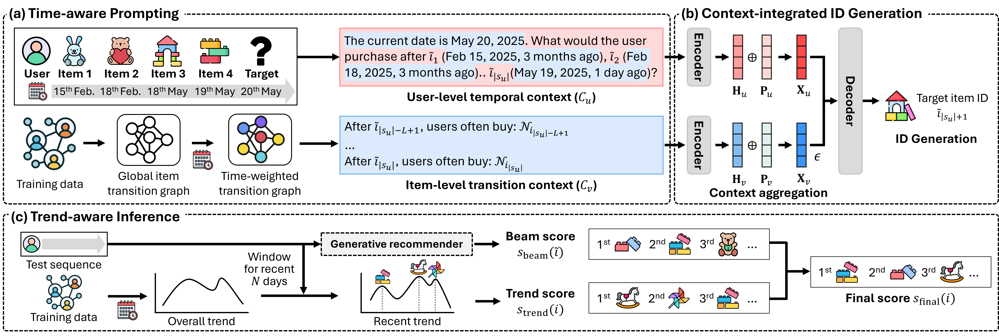

# Enhancing Time Awareness in Generative Recommendation (EMNLP'25 Findings)


[](https://aclanthology.org/2025.findings-emnlp.1300/)
[](https://arxiv.org/pdf/2509.13957)
[](https://www.python.org/downloads/release/python-390/)
[](https://pytorch.org/)


This is the official implementation for the paper: "*Enhancing Time Awareness in Generative Recommendation*".

## 🔍 Overview
**GRUT** (**G**enerative **R**ecommender **U**sing **T**ime awareness) is a novel generative recommendation system that effectively captures hidden user preferences via various temporal signals. It is built on top of [**GRAM** (ACL'25)](https://github.com/skleee/GRAM), extending its semantic-aware multi-granular late fusion with time-aware prompting and trend-aware inference. The repository ships both pipelines, so GRAM and GRUT can be trained and evaluated side-by-side from a single codebase.


<div align="center">
  
</div>

### 📖 Resources

- 📄 **Paper**: [ACL Anthology](https://aclanthology.org/2025.findings-emnlp.1300/) | [arXiv](https://arxiv.org/pdf/2509.13957)
- 🎨 **Presentation**: [Poster](assets/grut_poster.pdf) | [Slides](assets/grut_slide.pdf)
- 📝 **Blog Post**: [Korean](https://dial.skku.edu/blog/2025_grut)


## 🛠️ Environment Setup

### Requirements
- **Python**: 3.9+
- **PyTorch**: 1.11.0
- **Transformers**: 4.26.0
- **CUDA**: 11.3

### Installation

1. **Clone the repository**
```bash
git clone https://github.com/skleee/GRUT.git
cd GRUT
```

2. **Create conda environment**
```bash
conda create -n grut python=3.9
conda activate grut
```

3. **Install dependencies**
```bash
# Install general dependencies
pip install -r requirements.txt

# Install PyTorch with CUDA support
pip install torch==1.11.0+cu113 torchvision==0.12.0+cu113 torchaudio==0.11.0 \
    --extra-index-url https://download.pytorch.org/whl/cu113
```

## 📊 Datasets

We evaluate GRUT on **4 datasets** from two domains:

### Amazon Review Datasets
- Product reviews from Amazon with rich metadata
  - **Beauty**: Cosmetics and personal care products
  - **Toys**: Children's toys and gaming products
  - **Sports**: Sports equipment and outdoor gear

### Yelp Dataset
- **Yelp**: Local business reviews and ratings

### Data Sources
- **Amazon Review**: [Official Dataset](https://jmcauley.ucsd.edu/data/amazon/)
- **Yelp**: [Official Dataset](https://business.yelp.com/data/resources/open-dataset/)
- **Preprocessed Data**: Available in `rec_datasets/` directory

For more details on the dataset structure, please refer to [README.md](rec_datasets/README.md) in the `rec_datasets/` directory.

## 🚀 Training

Execute the training scripts located in the `command/` folder. Each script bakes in the paper-final hyperparameters for its dataset:

```bash
# Amazon Beauty dataset
bash train_grut_beauty.sh

# Amazon Toys dataset
bash train_grut_toys.sh

# Amazon Sports dataset
bash train_grut_sports.sh

# Yelp dataset
bash train_grut_yelp.sh
```


## Trend-aware Inference

GRUT's trend-aware reranking is a two-step inference workflow.

1. **Tune the trend mixing weight λ on the validation set**

```bash
bash test_grut_tune_valid.sh -d Beauty -e 30 -g 0 -c <CHECKPOINT_DIR>
```

This grid-searches λ ∈ {0.1, 0.2, …, 1.0}. The first λ runs full beam search and caches the predictions to disk; subsequent λ values reuse the cache and only redo the (fast) score-adjustment step. Pick the λ that maximizes validation NDCG@5.

2. **Final test evaluation with the chosen λ**

```bash
bash test_grut_test.sh -d Beauty -e 30 -g 0 -l 0.3 -c <CHECKPOINT_DIR>
```

`-l 0.3` is the chosen λ. Test-set predictions are cached for reuse.

`<CHECKPOINT_DIR>` points to the directory containing `model_rec_phase_1_epoch_<EPOCH>.pt`, e.g. `log/Beauty/<run_id>/id_0_rec_30/`.

## 🙏 Acknowledgments

This work builds upon several open-source projects:
- [**GRAM**](https://github.com/skleee/GRAM): Generative Recommendation via Semantic-aware Multi-granular Late Fusion
- [**IDGenRec**](https://github.com/agiresearch/IDGenRec): Generative recommendation framework
- [**OpenP5**](https://github.com/agiresearch/OpenP5): Open-source P5 implementation
- [**FiD**](https://github.com/facebookresearch/FiD): Fusion-in-Decoder architecture


## 📜 Citation

If you find this work helpful, please consider citing our paper:

```bibtex
@inproceedings{lee2025grut,
  title     = {Enhancing Time Awareness in Generative Recommendation},
  author    = {Sunkyung Lee and Seongmin Park and Jonghyo Kim and Mincheol Yoon and Jongwuk Lee},
  booktitle = {Findings of the Association for Computational Linguistics: EMNLP 2025},
  pages     = {23917--23933},
  year      = {2025},
  url       = {https://aclanthology.org/2025.findings-emnlp.1300/}
}
```
